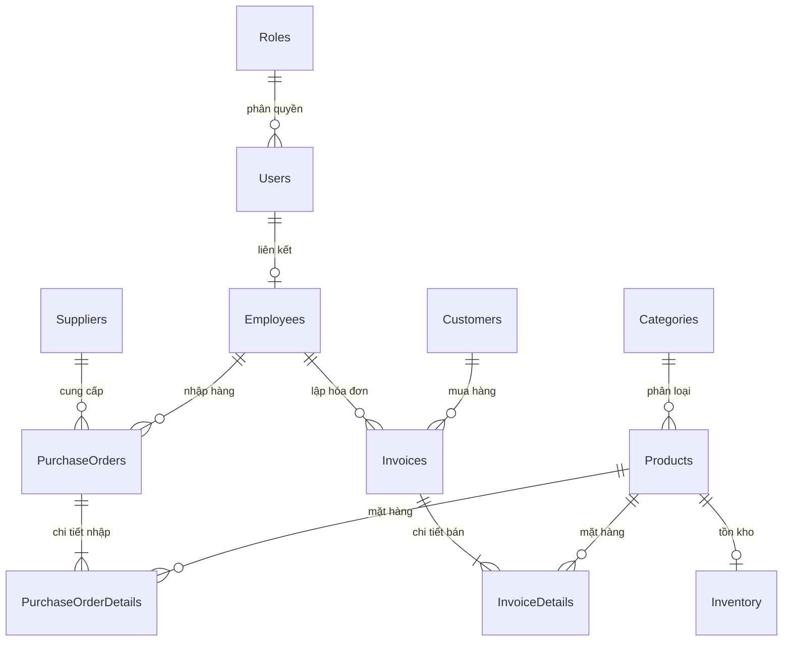

# Store Management System (Hệ thống Quản lý Cửa hàng Bán lẻ)
> **Đồ án môn học: Thực hành Cơ sở dữ liệu (Database Lab)**  
> **Công nghệ:** SQL Server (SSMS) + Node.js (Express API) + Web Frontend (HTML5 / CSS3 / Vanilla JS)

---

## 📌 1. Giới thiệu Đề tài

Hệ thống được thiết kế theo đúng mô hình quản lý thực tế của một **cửa hàng bán lẻ tổng hợp tại Việt Nam** (siêu thị mini, cửa hàng tiện lợi, tạp hóa hiện đại), xử lý đầy đủ các nghiệp vụ cốt lõi:
1. **Quản lý danh mục & hàng hóa**: Hỗ trợ mã SKU, mã vạch Barcode (EAN-13), đơn vị tính tiếng Việt (Lon, Chai, Hộp, Gói...), kiểm soát giá vốn và giá niêm yết bán lẻ.
2. **Quản lý tồn kho**: Tự động liên kết khi thêm sản phẩm, cảnh báo hàng sắp hết hoặc hết hàng.
3. **Quản lý khách hàng (CRM)**: Nhận diện khách hàng qua số điện thoại 10 số, lưu vết tổng chi tiêu tích lũy.
4. **Điểm bán hàng (POS Checkout)**: Thu ngân chọn mặt hàng, tra cứu khách hàng, chiết khấu, tự động trừ tồn kho và tính doanh thu thông qua giao dịch ACID.
5. **Nhập kho từ nhà cung cấp**: Lập phiếu nhập, tự động cộng dồn tồn kho qua kỹ thuật MERGE / Upsert và cập nhật giá vốn.
6. **Báo cáo & Thống kê**: Biểu đồ doanh thu trực quan, top sản phẩm bán chạy, báo cáo chi tiết từng ngày trong tháng.

---

## 🗄️ 2. Cấu trúc Cơ sở Dữ liệu (11 Bảng)

Cơ sở dữ liệu `StoreManagementDB` được chuẩn hóa đạt **Chuẩn 3NF**, sử dụng tiếng Việt Unicode (`NVARCHAR`), Collation `Vietnamese_CI_AS` và đơn vị tiền tệ VNĐ (`DECIMAL(18, 0)`):



### Chi tiết các bảng:
1. `Roles`: Phân quyền người dùng (Admin, Manager, Cashier).
2. `Users`: Tài khoản đăng nhập hệ thống.
3. `Employees`: Thông tin hồ sơ nhân viên, chức vụ, mức lương, số điện thoại, CCCD.
4. `Categories`: Danh mục ngành hàng (Đồ uống, Thực phẩm, Hóa mỹ phẩm...).
5. `Products`: Danh mục sản phẩm, mã vạch barcode, giá vốn, giá bán (`CHECK (SellingPrice >= CostPrice)`).
6. `Customers`: Hồ sơ khách hàng, số điện thoại (`CHECK (Phone LIKE '0%')`), tổng chi tiêu.
7. `Suppliers`: Danh sách nhà cung cấp hàng hóa.
8. `Inventory`: Số lượng tồn kho thực tế của từng sản phẩm.
9. `PurchaseOrders`: Phiếu nhập hàng từ nhà cung cấp.
10. `PurchaseOrderDetails`: Chi tiết từng mặt hàng nhập, đơn giá nhập, thành tiền.
11. `Invoices`: Hóa đơn bán lẻ thanh toán tại quầy thu ngân POS.
12. `InvoiceDetails`: Chi tiết từng món hàng bán ra, đơn giá tại thời điểm bán.

---

## 🎓 3. Bảng Tổng hợp Kỹ thuật SQL Server (Đáp ứng Tiêu chí Chấm điểm)

Dự án triển khai đầy đủ và trọn vẹn tất cả các kỹ thuật nâng cao trên SSMS:

| Kỹ thuật SQL | Tên đối tượng / File | Vai trò và điểm nhấn kỹ thuật |
|---|---|---|
| **Tables & Constraints** | `database/02_CreateTables.sql` | 11 bảng, Khóa chính `IDENTITY(1,1)`, Khóa ngoại `FOREIGN KEY` với `ON DELETE CASCADE / SET NULL`, Ràng buộc `CHECK`, `UNIQUE`, `DEFAULT`. |
| **Views** | `database/03_CreateViews.sql` | • `vw_ProductStock`: Trạng thái hàng hóa (Bình thường / Sắp hết / Hết hàng).<br>• `vw_RevenueByDate`: Tổng hợp doanh thu và số lượng đơn hàng theo ngày.<br>• `vw_EmployeeSales`: Đánh giá năng suất bán hàng của từng nhân viên. |
| **User-Defined Functions** | `database/04_CreateFunctions.sql` | • `fn_GetTotalRevenue` (Scalar Function): Tính tổng tiền bán trong khoảng ngày.<br>• `fn_GetTopSellingProducts` (Table-Valued Function): Trả về bảng top sản phẩm bán chạy nhất. |
| **Stored Procedures** | `database/05_CreateStoredProcedures.sql` | • `sp_CreateInvoice`: Quy trình bán hàng POS (bóc tách JSON, kiểm tra tồn kho, sinh mã HĐ, trừ tồn, cộng chi tiêu).<br>• `sp_ImportGoods`: Nhập hàng từ NCC (sử dụng câu lệnh `MERGE` để upsert tồn kho).<br>• `sp_SearchProducts`: Tìm kiếm phân trang (`OFFSET ... FETCH NEXT`).<br>• `sp_GetDashboardStats`: Trả về nhiều Result Sets cùng lúc cho giao diện.<br>• `sp_MonthlyReport`: **Kỹ thuật Cursor**. |
| **Triggers** | `database/06_CreateTriggers.sql` | • `trg_PreventDeleteInvoice` (`INSTEAD OF DELETE`): Chặn hành vi xóa hóa đơn, bảo toàn tính bất biến của chứng từ kế toán.<br>• `trg_AutoCreateInventory` (`AFTER INSERT`): Tự động tạo bản ghi tồn kho khi thêm sản phẩm mới.<br>• `trg_UpdateProductTimestamp` (`AFTER UPDATE`): Tự động cập nhật thời gian sửa đổi `UpdatedAt`. |
| **Indexes** | `database/07_CreateIndexes.sql` | • `IX_Products_Barcode`: Filtered Index trên Barcode hỗ trợ máy quét mã vạch.<br>• `IX_Customers_Phone`: Index trên SĐT khách hàng.<br>• `IX_Invoices_Date_Status`: Covering Index tối ưu hóa truy vấn báo cáo. |
| **Transactions & ACID** | Trong `sp_CreateInvoice`, `sp_ImportGoods` | `BEGIN TRANSACTION`, `COMMIT TRANSACTION`, `ROLLBACK TRANSACTION`, `TRY...CATCH` và `SET XACT_ABORT ON` đảm bảo toàn vẹn dữ liệu. |
| **Cursors** | `sp_MonthlyReport` | Minh chứng đầy đủ vòng đời Cursor: `DECLARE ... CURSOR FOR`, `OPEN`, `FETCH NEXT`, `WHILE @@FETCH_STATUS = 0`, `CLOSE`, `DEALLOCATE`. |

---

## 🚀 4. Hướng dẫn Chạy Dự án trên Máy tính

### Bước 1: Chạy SQL Scripts trên SSMS (SQL Server Management Studio)
Mở SSMS, kết nối vào SQL Server và mở lần lượt các file trong thư mục `database/` theo đúng thứ tự (nhấn **F5** hoặc nút **Execute** cho từng file):
1. `01_CreateDatabase.sql`: Tạo database `StoreManagementDB`.
2. `02_CreateTables.sql`: Tạo 11 bảng dữ liệu và ràng buộc.
3. `03_CreateViews.sql`: Tạo 3 Views báo cáo.
4. `04_CreateFunctions.sql`: Tạo Function tính doanh thu & bảng top sản phẩm.
5. `05_CreateStoredProcedures.sql`: Tạo 5 Stored Procedures nghiệp vụ.
6. `06_CreateTriggers.sql`: Tạo Triggers kiểm soát nghiệp vụ.
7. `07_CreateIndexes.sql`: Tạo các chỉ mục tối ưu truy vấn.
8. `08_SeedData.sql`: Nạp sẵn dữ liệu mẫu thực tế tiếng Việt.

### Bước 2: Cấu hình kết nối SQL Server
Mở file `server/.env` và cập nhật thông tin đăng nhập SQL Server của bạn nếu cần:
```ini
DB_USER=sa
DB_PASSWORD=123
DB_SERVER=localhost
DB_NAME=StoreManagementDB
DB_PORT=1433
PORT=3000
```
> **Lưu ý quan trọng đối với SQL Server:**
> - Bật **SQL Server and Windows Authentication mode** trong Server Properties -> Security.
> - Mở **SQL Server Configuration Manager** -> **Protocols for MSSQLSERVER** -> Bật **TCP/IP** (Port 1433).
> - Đảm bảo tài khoản `sa` đã được Enable (hoặc dùng tài khoản có quyền db_owner).

### Bước 3: Khởi động Backend Server
Mở terminal tại thư mục `server/`:
```bash
# Cài đặt thư viện (nếu chưa cài)
npm install

# Khởi chạy server
npm start
```
Khi thấy dòng thông báo sau là server đã sẵn sàng:
```
✅ Kết nối SQL Server thành công!
🚀 Server đang chạy tại http://localhost:3000
📂 Frontend: http://localhost:3000/pages/login.html
```

### Bước 4: Trải nghiệm Giao diện Web
Mở trình duyệt web và truy cập địa chỉ:
👉 **`http://localhost:3000/pages/login.html`** (hoặc mở trực tiếp file `client/pages/login.html`)

**Tài khoản đăng nhập demo:**
- `admin` / `admin123` (Vai trò Admin - Toàn quyền)
- `manager01` / `manager123` (Vai trò Quản lý cửa hàng)
- `cashier01` / `cashier123` (Vai trò Thu ngân)

---

## 🎯 5. Kịch bản Demo Báo cáo với Giảng viên (Đạt điểm tối đa)

1. **Demo Bán hàng POS & Transaction**:
   - Vào trang **Bán hàng POS** (`pages/pos.html`).
   - Nhập SĐT khách hàng `0901111222` -> Hệ thống tự hiển thị khách hàng **Nguyễn Thị Mai**.
   - Chọn mua mặt hàng (ví dụ: Coca Cola).
   - Bấm **Thanh toán (F9)** -> Hệ thống gọi Stored Procedure `sp_CreateInvoice`:
     - Kiểm tra tồn kho trước khi bán.
     - Sinh mã hóa đơn tự động dạng `HD-2026xxxx-xxxx`.
     - Trừ số lượng trong bảng `Inventory`.
     - Cộng dồn `TotalSpent` cho khách hàng.
     - Hiển thị hóa đơn chuẩn có thể bấm **In hóa đơn**.
2. **Demo Nhập hàng & Kỹ thuật MERGE**:
   - Vào trang **Nhập hàng** (`pages/purchase.html`).
   - Chọn Nhà cung cấp Unilever, chọn sản phẩm và số lượng.
   - Bấm **Xác nhận nhập kho** -> Hệ thống gọi `sp_ImportGoods`, dùng câu lệnh `MERGE` cộng dồn tồn kho và cập nhật giá vốn.
3. **Demo Ràng buộc toàn vẹn & Trigger**:
   - Trên SSMS, thử xóa 1 hóa đơn: `DELETE FROM Invoices WHERE InvoiceID = 1;`
   - Trigger `trg_PreventDeleteInvoice` sẽ chặn lại và báo lỗi nghiệp vụ rõ ràng.
   - Thử thêm sản phẩm với Giá bán < Giá vốn -> Constraint `CK_Products_PriceLogic` chặn lại ngay lập tức.
4. **Demo Cursor & Views trên Báo cáo**:
   - Vào trang **Báo cáo** (`pages/reports.html`).
   - Tab 1: Xem biểu đồ doanh thu lấy từ View `vw_RevenueByDate`.
   - Tab 2: Xem top mặt hàng từ Function dạng bảng `fn_GetTopSellingProducts`.
   - Tab 3: Bấm **Thực thi Cursor** -> Stored Procedure `sp_MonthlyReport` dùng con trỏ duyệt từng ngày trong tháng và trả về bảng số liệu chi tiết.
